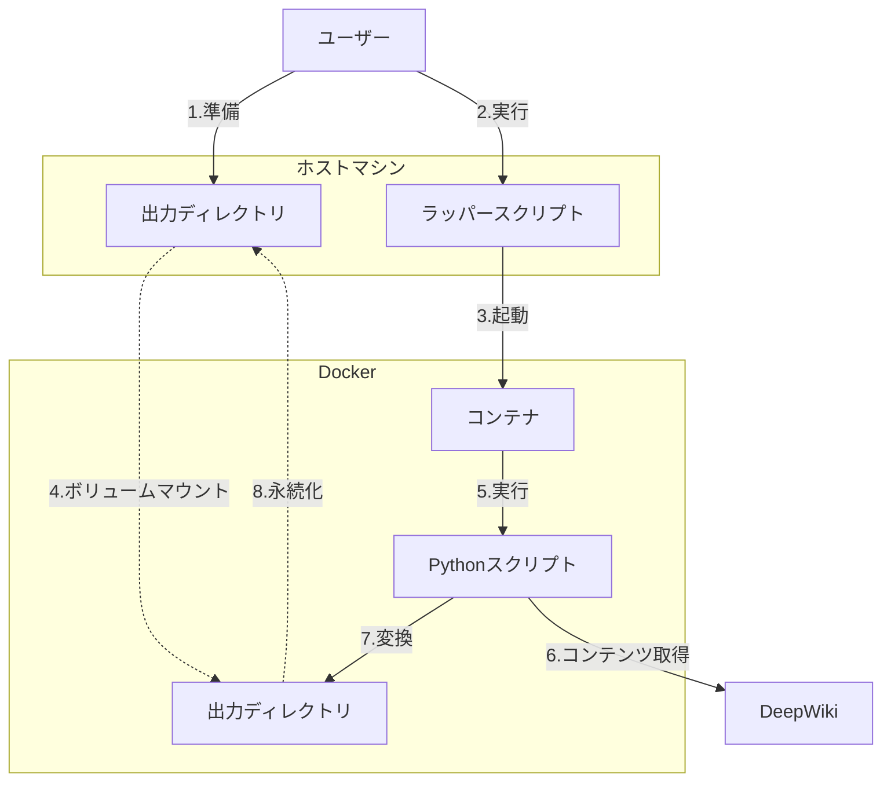
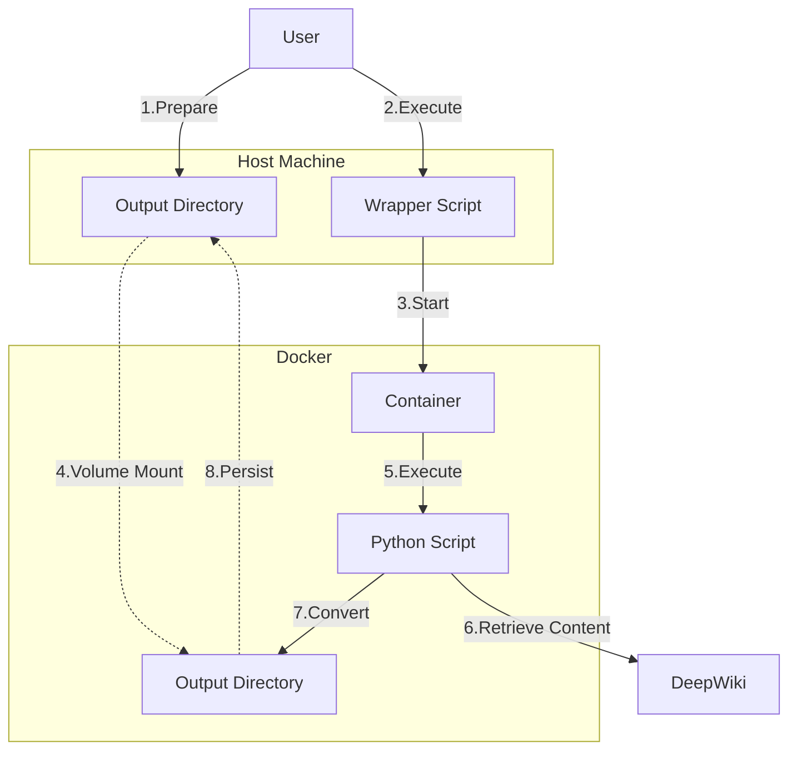

# deepwiki-to-md


## Table of Contents

1. [日本語 (Japanese)](#日本語-japanese)
   - [概要](#1-概要)
   - [Getting Started](#2-getting-started)
   - [コマンドライン仕様](#3-コマンドライン仕様)
2. [English (英語)](#english-英語)
   - [Overview](#1-overview)
   - [Getting Started](#2-getting-started-1)
   - [Command Line Specification](#3-command-line-specification)

---

## 日本語 (Japanese)

## 1. 概要

`deepwiki-to-md`は、DeepWikiのコンテンツ（リポジトリのWikiやチャットログ）をMarkdown形式でローカルに保存するためのCLIツールです。
このプロジェクトにより、ユーザーはDeepWiki上の情報を簡単にエクスポートし、ローカル環境で管理・活用できます。

### 1.1. 目的

1.  DeepWikiのチャットログをMarkdown形式で取得できるようにします。
2.  DeepWikiのWikiコンテンツをMarkdown形式で取得できるようにします。
3.  Mermaidの図も適切に変換・保存して再利用できるようにします。

## 2. Getting Started

### 2.1. インストール

1.  **前提条件**:
    * Dockerがインストールされていること
2.  **ラッパースクリプトのダウンロード**:
    * 任意のディレクトリに配置します。
        ```bash
        # 例: ~/my_deepwiki_exports に配置する場合
        mkdir -p ~/my_deepwiki_exports
        curl -Lo ~/my_deepwiki_exports/deepwiki-to-md https://raw.githubusercontent.com/suwa-sh/deepwiki-to-md/refs/heads/main/bin/deepwiki-to-md
        chmod +x ~/my_deepwiki_exports/deepwiki-to-md
        ```
3.  **ツールの実行**:
    * **リポジトリWikiの取得例**:
        ```bash
        ~/my_deepwiki_exports/deepwiki-to-md wiki https://deepwiki.com/yourgroup/yourrepo
        ```
    * **チャットログの取得例**:
        ```bash
        ~/my_deepwiki_exports/deepwiki-to-md chat https://deepwiki.com/search/yourchatid
        ```

### 2.1. 提供物

1.  **Dockerイメージ (suwash/deepwiki-to-md)**
    * ツール本体のPythonスクリプト、Playwright、必要なブラウザドライバ、その他依存ライブラリを全て含みます。
    * Docker Hubで公開しています。
      * [suwash/deepwiki-to-md](https://hub.docker.com/r/suwash/deepwiki-to-md)
2.  **ラッパースクリプト (`deepwiki-to-md`)**
    * ユーザーが直接ダウンロードして利用するシェルスクリプトです。
    * このスクリプトがDockerコマンドの実行を抽象化します。
    * GitHubで管理しています。
      * [bin/deepwiki-to-md](bin/deepwiki-to-md)

### 2.2. システム構成と動作フロー

以下の図は、`deepwiki-to-md`のシステム構成とユーザーがコマンドを実行した際の動作フローを示します。



**ディレクトリ構造のイメージ（ユーザーのホストマシン上）:**

```
任意のディレクトリ/  ※例: ~/my_deepwiki_exports/
    deepwiki-to-md      <-- ラッパースクリプト本体
    wiki/
        yourgroup/
            yourrepo/
                1-overview.md
                2-details.md
                images/
                    diagram1.svg
    chat/
        yourchatid/
            chat.md
            images/
                diagram1.svg
```

## 3. コマンドライン仕様

基本的なコマンド構文は以下です。
```bash
./deepwiki-to-md <サブコマンド> <URL> [-o <出力ベースディレクトリ>]
```

* `<サブコマンド>`: `wiki` または `chat` を指定します。
* `<URL>`: 対象のDeepWikiページのURLを指定します。
* `-o <出力ベースディレクトリ>` (オプション): Markdownファイルや画像が出力されるベースディレクトリを指定します。デフォルトはラッパースクリプトを配置したディレクトリです。

**例:**

* **リポジトリWikiの取得**:
    ```bash
    ./deepwiki-to-md wiki https://deepwiki.com/yourgroup/yourrepo
    ```
    出力先: `./wiki/yourgroup/yourrepo/`

* **チャットログの取得**:
    ```bash
    ./deepwiki-to-md chat https://deepwiki.com/search/yourchatid
    ```
    出力先: `./chat/yourchatid/`

* **出力ベースディレクトリを指定してリポジトリWikiを取得**:
    ```bash
    ./deepwiki-to-md wiki https://deepwiki.com/yourgroup/yourrepo -o /path/to/custom_output
    ```
    出力先: `/path/to/custom_output/wiki/yourgroup/yourrepo/`

---

## English (英語)

## 1. Overview

`deepwiki-to-md` is a CLI tool for saving DeepWiki content (repository wikis and chat logs) locally in Markdown format.
This project allows users to easily export information from DeepWiki and manage/utilize it in their local environment.

### 1.1. Purpose

1. Enable retrieval of DeepWiki chat logs in Markdown format.
2. Enable retrieval of DeepWiki Wiki content in Markdown format.
3. Properly convert and save Mermaid diagrams for reuse.

## 2. Getting Started

### 2.1. Installation

1. **Prerequisites**:
   * Docker must be installed
2. **Download the wrapper script**:
   * Place it in any directory.
       ```bash
       # Example: placing in ~/my_deepwiki_exports
       mkdir -p ~/my_deepwiki_exports
       curl -Lo ~/my_deepwiki_exports/deepwiki-to-md https://raw.githubusercontent.com/suwa-sh/deepwiki-to-md/refs/heads/main/bin/deepwiki-to-md
       chmod +x ~/my_deepwiki_exports/deepwiki-to-md
       ```
3. **Run the tool**:
   * **Example: Retrieving repository Wiki**:
       ```bash
       ~/my_deepwiki_exports/deepwiki-to-md wiki https://deepwiki.com/yourgroup/yourrepo
       ```
   * **Example: Retrieving chat logs**:
       ```bash
       ~/my_deepwiki_exports/deepwiki-to-md chat https://deepwiki.com/search/yourchatid
       ```

### 2.1. Deliverables

1. **Docker Image (suwash/deepwiki-to-md)**
   * Contains the Python script of the tool itself, Playwright, required browser drivers, and all other dependent libraries.
   * Published on Docker Hub.
     * [suwash/deepwiki-to-md](https://hub.docker.com/r/suwash/deepwiki-to-md)
2. **Wrapper Script (`deepwiki-to-md`)**
   * A shell script that users download and use directly.
   * This script abstracts the execution of Docker commands.
   * Managed on GitHub.
     * [bin/deepwiki-to-md](bin/deepwiki-to-md)

### 2.2. System Architecture and Operation Flow

The diagram below shows the system architecture of `deepwiki-to-md` and the operation flow when a user executes a command.



**Directory Structure Image (on user's host machine):**

```
arbitrary_directory/  ※Example: ~/my_deepwiki_exports/
    deepwiki-to-md      <-- Wrapper script itself
    wiki/
        yourgroup/
            yourrepo/
                1-overview.md
                2-details.md
                images/
                    diagram1.svg
    chat/
        yourchatid/
            chat.md
            images/
                diagram1.svg
```

## 3. Command Line Specification

The basic command syntax is as follows:
```bash
./deepwiki-to-md <subcommand> <URL> [-o <output_base_directory>]
```

* `<subcommand>`: Specify either `wiki` or `chat`.
* `<URL>`: Specify the URL of the target DeepWiki page.
* `-o <output_base_directory>` (optional): Specify the base directory where Markdown files and images will be output. The default is the directory where the wrapper script is placed.

**Examples:**

* **Retrieving repository Wiki**:
    ```bash
    ./deepwiki-to-md wiki https://deepwiki.com/yourgroup/yourrepo
    ```
    Output destination: `./wiki/yourgroup/yourrepo/`

* **Retrieving chat logs**:
    ```bash
    ./deepwiki-to-md chat https://deepwiki.com/search/yourchatid
    ```
    Output destination: `./chat/yourchatid/`

* **Retrieving repository Wiki with specified output base directory**:
    ```bash
    ./deepwiki-to-md wiki https://deepwiki.com/yourgroup/yourrepo -o /path/to/custom_output
    ```
    Output destination: `/path/to/custom_output/wiki/yourgroup/yourrepo/`
